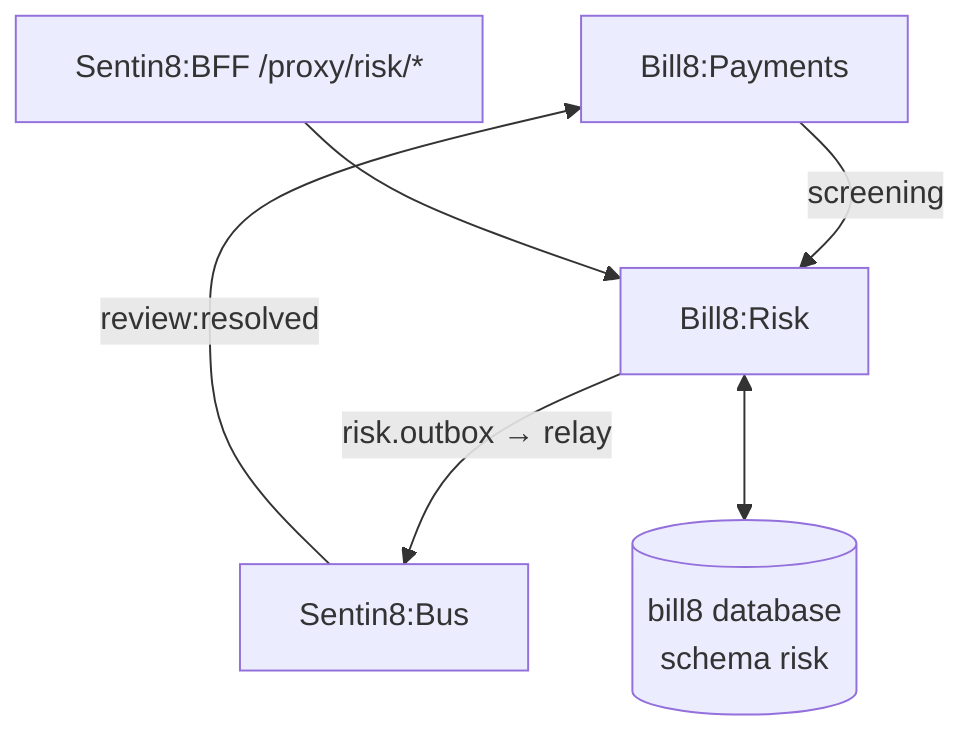

# Bill8:Risk - Fraud Prevention

Fraud rules, velocity checks, sanctions screening, and the review queue.

## 1. Summary

Bill8:Risk owns fraud prevention: declarative rules and velocity
checks that screen charges before money moves, sanctions screening, and a
review queue for manual adjudication.

## 2. Motivation

A billing platform must block or review bad actors before funds move.
Centralizing screening keeps fraud logic out of payment orchestration and
gives operators a single review surface.

## 3. Architecture & High-Level Design

## 4. Key Traits and Data Structures

- `Rule` - a declarative predicate (`amount > X`, `country in {…}`,
  `velocity > N`) with an action (`block` / `review` / `allow`).
- `Review` - a queued case with a status (`open` → `approved` /
  `declined`).
- `Screening` - a sanctions/deny-list match result.

## 5. Rationale, Trade-offs, and Alternatives

- **Inline pre-authorization** over post-hoc audit: screening happens
  before money moves, so a block prevents a bad charge rather than
  flagging it after.
- **Declarative rules** over hardcoded checks: operators tune rules
  without engineering work.

## 6. Internal Implementation & Invariants

- A rule's action is applied before the charge commits.
- Review resolutions are idempotent and audit-journaled.
- Screening results are retained for audit.

## 7. Unresolved Questions / Future Designs

- See `DESIGN.md` §10.

---

**Design attribution:** bill8:risk and its underlying concepts were designed by Hamid Jahanzad <Hamid@Jahanzad.com>.
